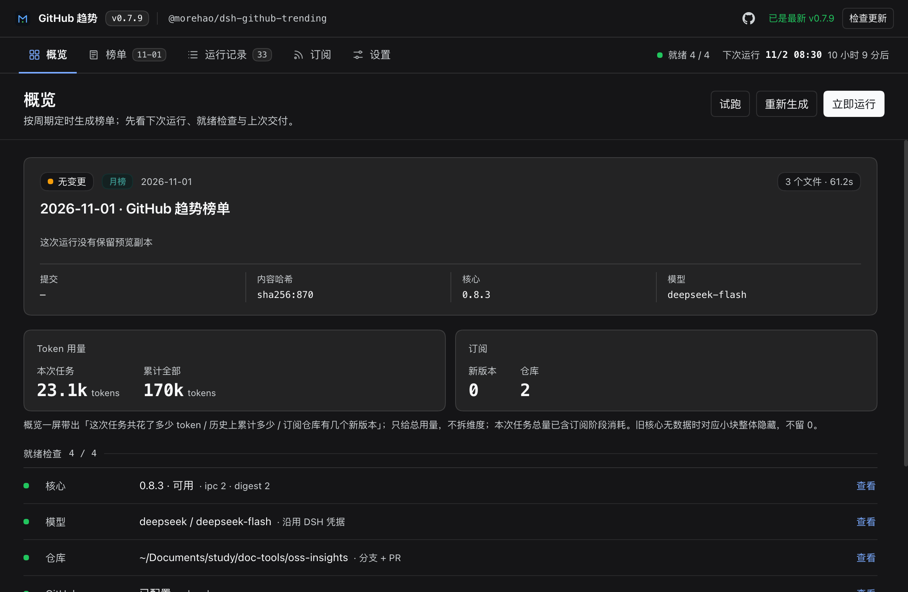
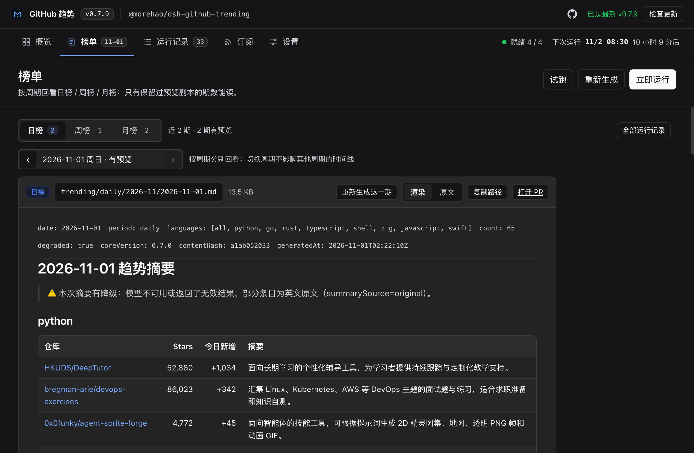
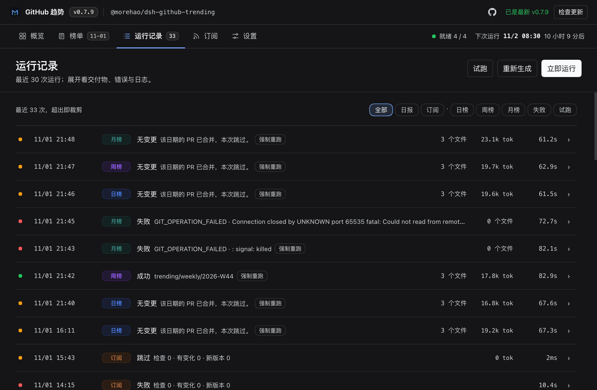
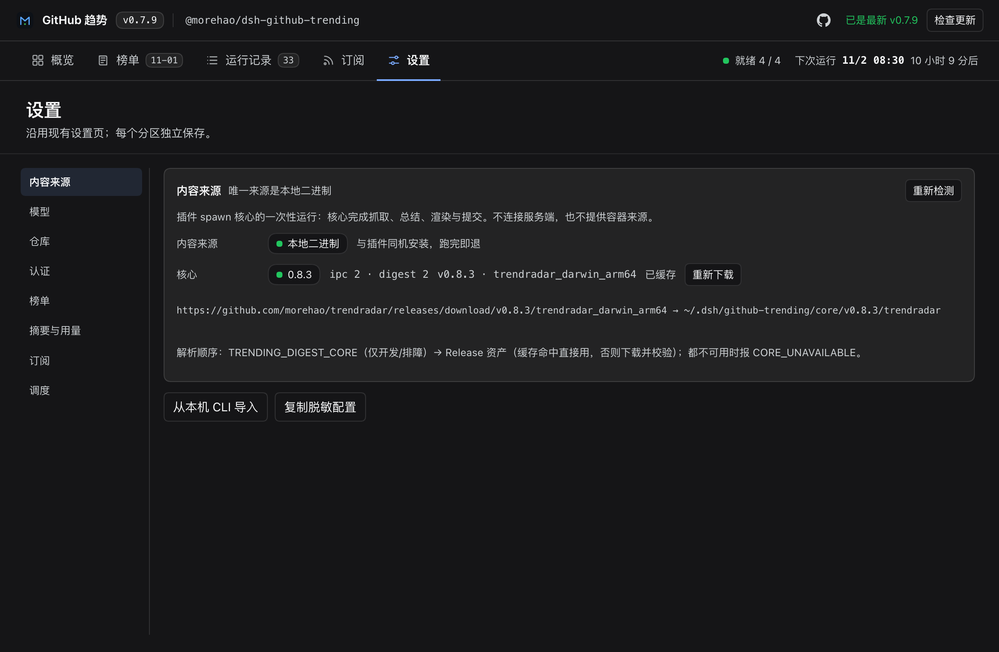
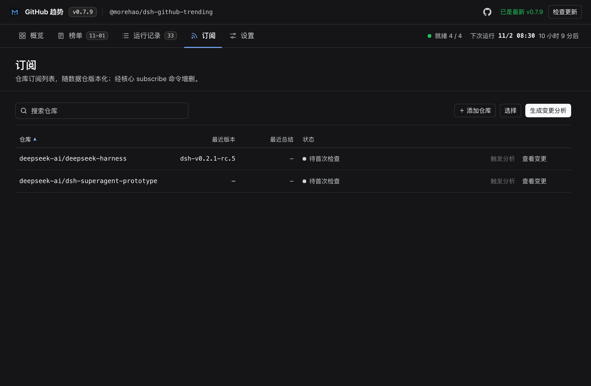

<p align="center">
  
</p>

<h1 align="center">dsh-github-trending</h1>

<p align="center">
  A DeepSeek Harness plugin for the GitHub Trending board
</p>

<p align="center">
  <a href="README.md">简体中文</a> | English
</p>

<p align="center">
  <a href="https://github.com/morehao/dsh-github-trending/actions/workflows/check.yml"></a>
  <a href="https://www.npmjs.com/package/@morehao/dsh-github-trending"></a>
</p>

A **DeepSeek Harness plugin** for the GitHub Trending board: it schedules daily / weekly / monthly digests, hands them to the local [`trendradar`](https://github.com/morehao/trendradar) core to scrape Trending, write Chinese intros and period summaries, and commits the result to your own repository with a PR merged automatically. You follow status, read digests and manage subscriptions from the workbench — no command line needed.

## Positioning

- **An entry point, not an engine**. Scraping, parsing, model summarization, rendering, git and PR all live in one place — the local `trendradar` core. The plugin only handles **configuration, scheduling, spawning the core and displaying results**, so there is no second implementation to drift.
- **Deliver the artifact as-is**. Content is written byte-for-byte exactly as the core produces it; the plugin does not rewrite, reorder or re-invoke a model on it.
- **Local execution, no telemetry**. The core runs on your machine; the plugin has no cloud account, and secrets are handed to the core only over a runtime channel — never written to config files or logs.

> For deeper material — requirements, config fields, error codes, subscription stages and implementation details — see **[docs/reference.md](docs/reference.md)**.

## Features

Open the workbench from the sidebar **GitHub Trending** or `Settings → GitHub Trending`. It has five views:

### Overview

Answers "when will it run next, are the four readiness checks all green, what was delivered last time" at a glance. The top shows the plugin identity bar (version / package name / GitHub / check for updates); click the package name to open About. The right side keeps the next run and readiness N/4 always visible.



### Digest

Browse past digests by period (daily / weekly / monthly). Markdown is rendered directly (headings, lists, tables, links), and you can switch to **Raw**. Only issues whose preview copy was kept can be read; failed / unchanged / dry-run / old records each have their own empty state.



### Runs

The last 30 runs, filterable by success / failure / dry-run. Expand a run to see its deliverables (commit, content hash, branch, PR link) and a read-only log; the footer shows cumulative tokens.



### Settings

Six sections — Content source / Model / Repository / Auth / Digest / Schedule — each saved and validated independently; an unsaved section shows a yellow dot next to its item on the left.



### Subscriptions

(Optional) Subscribe to a set of repositories; each week the new Releases from each of them are merged into one Chinese summary and committed alongside the digest on the same branch and PR. The subscription list is versioned with the data repo, auditable and reproducible.



## Installation

```bash
dsh plugin --profile <profile> add @morehao/dsh-github-trending
```

Restart the host after installing, then open **GitHub Trending** from the sidebar or `Settings → GitHub Trending`.

### Quick start in three steps

1. **Pick a repository**: enter the absolute path of a local git repository (the plugin does not run `git init` for you; a non-repo path returns `REPO_NOT_GIT`).
2. **Pick a model**: click "Use DSH config" to choose a provider and model from the host's provider directory; providers that can export a key pass it straight to the core, while OAuth-type credentials go through a local loopback proxy.
3. **Dry-run once**: "Dry run (no commit)" only scrapes and renders — it writes no files and makes no commit.

Requirements: DSH `0.2.1-rc.3` or later, Node.js `^22.20.0 || >=24.0.0`, a local git ≥ 2.30 with a writable remote, and git / GitHub credentials (needed only for push and opening PRs). On first run the core binary is downloaded from GitHub Releases and verified by sha256, then reused offline.

## Development and release

```bash
npm install
npm run check            # typecheck + contract check + build + all tests
node scripts/ac/run.mjs  # AC-P mechanical checks
```

Releases go through **tag-triggered CI** (Trusted Publishing / OIDC): merge the PR → push an annotated tag `vX.Y.Z` on `main` → CI publishes to npm and creates the Release from the annotation body. See [docs/publishing.md](docs/publishing.md) for details.

## License

MIT
