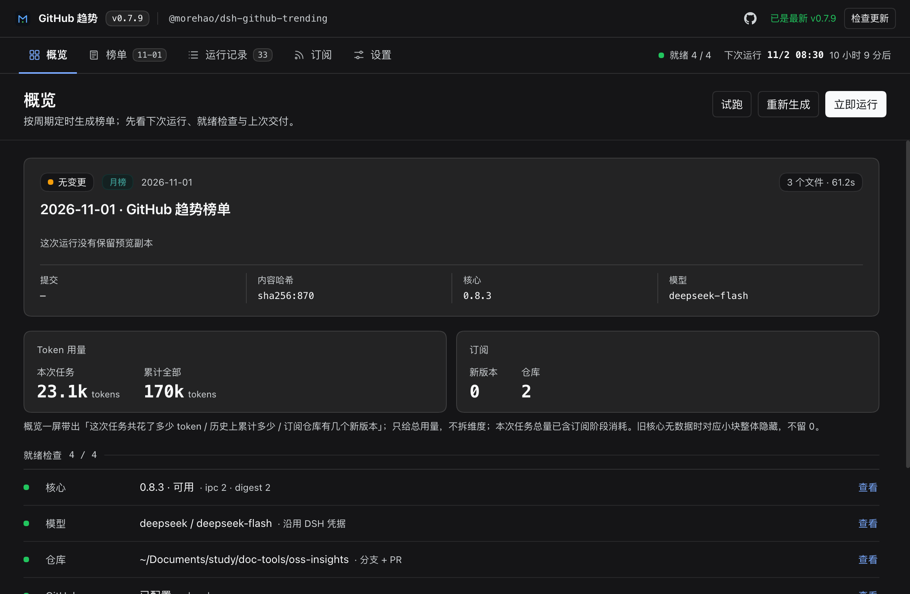
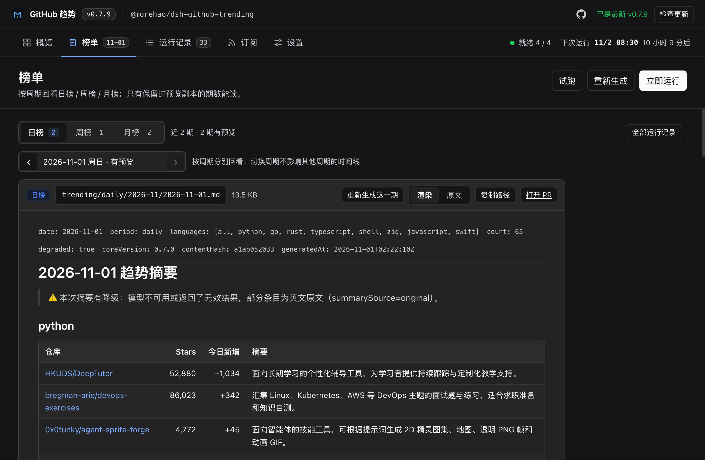
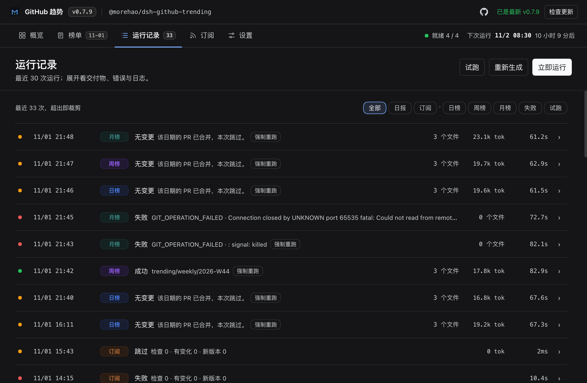
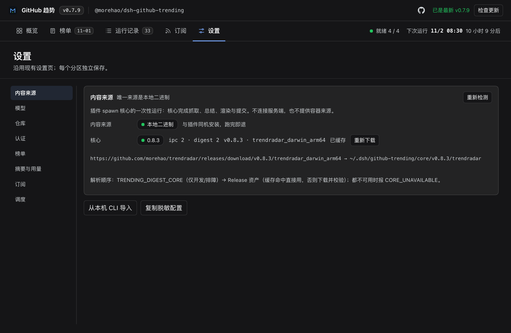
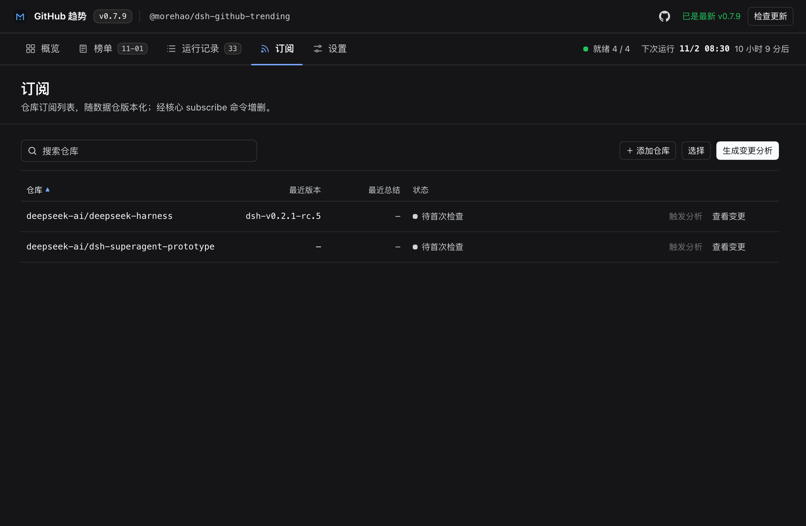

<p align="center">
  
</p>

<h1 align="center">dsh-github-trending</h1>

<p align="center">
  GitHub 趋势榜的 DeepSeek Harness 插件
</p>

<p align="center">
  简体中文 | <a href="README.en.md">English</a>
</p>

<p align="center">
  <a href="https://github.com/morehao/dsh-github-trending/actions/workflows/check.yml"></a>
  <a href="https://www.npmjs.com/package/@morehao/dsh-github-trending"></a>
</p>

GitHub 趋势榜的 **DeepSeek Harness 插件**：按日 / 周 / 月周期定时生成趋势日报，交给本地 [`trendradar`](https://github.com/morehao/trendradar) 核心抓取 Trending、写中文简介与周期总结，并自动提交到你自己的仓库、开 PR 合并。你在工作台里看状态、读榜单、管理订阅，不用盯命令行。

## 定位

- **它是入口，不是引擎**。抓取、解析、模型总结、渲染、git 与 PR 全在本地 `trendradar` 核心一处实现；插件只负责**配置、调度、spawn 核心、展示结果**，避免两份实现漂移。
- **成品原样落地**。内容按核心产出的 canonical 逐字节写入，插件不改写、不重排、不二次调用模型。
- **本地运行、无遥测**。核心在你的机器上跑；插件没有云端账号，密钥只经运行时通道交给核心，不写配置文件、不进日志。

> 需要什么、配置项、错误码、订阅阶段、实现细节等深入内容见 **[docs/reference.md](docs/reference.md)**。

## 功能说明

工作台从侧栏「GitHub 趋势」或 `设置 → GitHub 趋势` 进入，分五个视图：

### 概览

一屏回答「下次什么时候跑、四项就绪检查是否齐、上次交付了什么」。顶部是插件身份条（版本 / 包名 / 检查更新），右侧常驻下次运行与就绪 N/4。



### 榜单

按周期（日榜 / 周榜 / 月榜）回看历史榜单，直接渲染 Markdown（标题、列表、表格、链接），也可切「原文」。只有保留了预览副本的期数能读；失败 / 无变更 / 试跑 / 旧记录各有空状态。



### 运行记录

最近 30 次运行，按成功 / 失败 / 试跑筛选；展开某条看交付物（提交、内容哈希、分支、PR 链接）与只读日志，页脚给累计 token。



### 设置

内容来源 / 模型 / 仓库 / 认证 / 榜单 / 调度 六个分区，每个分区独立保存与校验；某分区有未保存改动时左侧对应项显示黄点。



### GitHub 认证

认证分区支持三种方式（可随时切换）：

- **浏览器登录（默认推荐）**：点「用 GitHub 登录」在浏览器完成授权，无需手工粘贴 token。走 OAuth PKCE + 本机回环回调（或设备码），token 由 DSH 凭据记录安全保存，不落 `settings.json`。插件内置了公开的 OAuth App client_id（client_id 属公开标识、非机密；纯 PKCE 不使用 client_secret），开箱即用。
- **本机 gh**：复用你终端里 `gh auth login` 的登录态。
- **PAT**：手工填 Personal Access Token（存到凭据引用 / 环境变量）。

> 浏览器登录需要核心提供 `authorization` 服务，并且 GitHub flow 注册成功才算可用；两者任一不满足时，设置页直接提示不可用并引导改用 gh / PAT，而不是给一个点了没反应的按钮。宿主启动时服务可能晚于插件就绪，插件会等服务就绪再注册，并在读状态时再兜底一次。
>
> 授权页默认尝试自动打开；若被浏览器的弹窗拦截，状态行里始终有可点的「打开授权页」链接与「复制链接」。

### 订阅

（可选）订阅一组仓库，每周把每个仓库当周新增的 Release 合成一段中文摘要，与榜单同分支、同 PR 一起提交；订阅列表随数据仓版本化，可审计、可复现。



## 安装

```bash
dsh plugin --profile <profile> add @morehao/dsh-github-trending
```

装完重启宿主，从侧栏「GitHub 趋势」或 `设置 → GitHub 趋势` 进入。

### 三步上手

1. **选仓库**：填本地 git 仓库的绝对路径（插件不替你 `git init`，不是仓库就报 `REPO_NOT_GIT`）。
2. **填模型**：点「沿用 DSH 配置」从宿主 provider 目录里挑 provider 与模型；可导出密钥的直接传给核心，OAuth 类凭据走本机回环代理。
3. **试跑一次**：「试跑（不提交）」只抓取与渲染，不写文件、不提交。

环境要求：DSH `0.2.1-rc.3` 以上、Node.js `^22.20.0 || >=24.0.0`、本地 git ≥ 2.30 与可写远端、git/GitHub 凭据（仅 push 与开 PR 需要）。核心二进制首次运行从 GitHub Release 下载并按 sha256 校验，之后离线复用。

## 开发与发版

```bash
npm install
npm run check            # typecheck + 契约校验 + 构建 + 全部测试
node scripts/ac/run.mjs  # AC-P 机械检查
```

发版走 **tag 触发的 CI**（Trusted Publishing / OIDC）：合并 PR → 在 `main` 打注记 tag `vX.Y.Z` → CI 发 npm 并用注记正文建 Release。细节见 [docs/publishing.md](docs/publishing.md)。

## 许可

MIT
